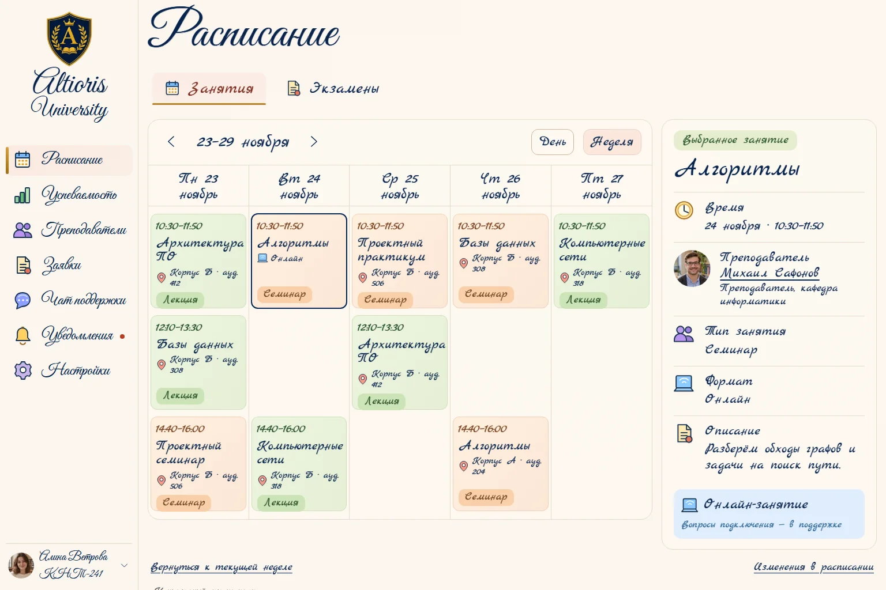
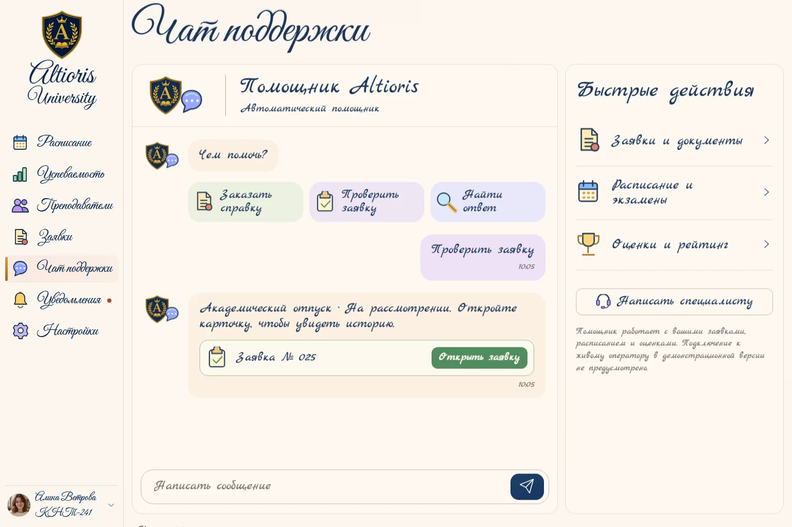
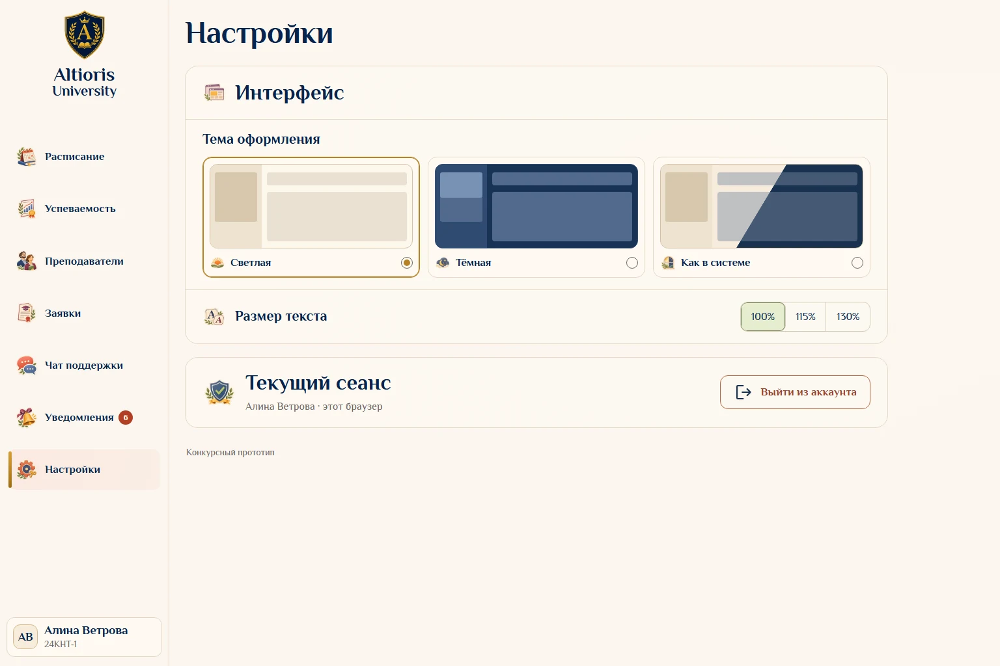
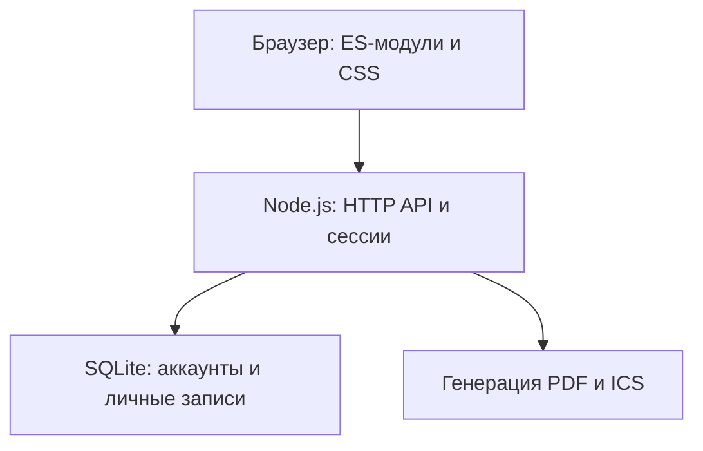

<p align="center"></p>

<h1 align="center">Altioris University</h1>
<p align="center">Цифровой деканат: от следующего занятия до готовой справки.</p>
<p align="center">
  <a href="https://github.com/sonjiwu2/altioris/actions/workflows/checks.yml"></a>
  <a href="https://nodejs.org/"></a>
  <a href="LICENSE"></a>
</p>

Altioris — русскоязычный учебный веб-сервис с личным кабинетом студента. Расписание, результаты обучения, рейтинг, преподаватели, заявки, PDF-документы и история общения с поддержкой связаны с текущим аккаунтом и сохраняются на сервере.

Интерфейс оформлен как университетский ежедневник: кремовая бумага, тёмно-синий прямой шрифт Philosopher, золотые детали и цветные карточки. Все шрифты и изображения поставляются вместе с приложением.



*Снимок реализации с вымышленными данными. Утверждённые дизайн-референсы собраны отдельно в [docs/references](docs/references/README.md).*

## Быстрый старт

Нужен **Node.js 24 или новее**. Внешних npm-зависимостей и отдельной сборки нет. Python нужен только для проверки референсов.

```powershell
git clone https://github.com/sonjiwu2/altioris.git
Set-Location altioris
npm.cmd run demo:init
notepad .\runtime\demo-accounts.json
```

В созданном JSON задайте каждому из 13 логинов свой постоянный пароль длиной **12–128 символов**, сохраните файл и выполните:

```powershell
npm.cmd run demo:setup
npm.cmd run dev
```

Откройте адрес из строки `Altioris is ready`. Обычно это **http://127.0.0.1:3000**; если порт занят, выбирается свободный. Остановка — `Ctrl+C` в окне сервера.

Логины подготовлены заранее: `vetrova`, `zolotov`, `orlova`, `gromov`, `belova`, `serov`, `lanskaya`, `severin`, `rudin`, `lesina`, `melnikov`, `safonova`, `volkov`. Пароли задаются отдельно для каждой установки и не публикуются. Их локальная таблица после проверки — `runtime/ACCOUNTS.txt`.

**Для уже настроенной копии достаточно `npm.cmd run dev`.** Повторные `demo:init` и `demo:setup` не заменяют пароли. Это постоянные аккаунты, без одноразовых кодов.

## Возможности

| Раздел | Что реализовано |
| --- | --- |
| Расписание | Неделя на широком экране, день на телефоне, навигация стрелками, время, аудитория, преподаватель и формат |
| Экзамены | Назначенные и ожидающие назначения экзамены, подробности и экспорт ICS |
| Успеваемость | Оценки, пересдачи, средний балл и GPA с весом в кредитах |
| Рейтинг | Место среди включённых аккаунтов, ближайшие участники и полный список |
| Преподаватели | Поиск, кафедры, биографии, консультации и копирование почты |
| Заявки и документы | Создание заявки, сохранённые статусы и история, собственный PDF |
| Поддержка | История диалога, быстрые действия, ответы по своим заявкам, оценкам и занятиям |
| Уведомления | Фильтры, отметки о прочтении, переходы к связанным разделам |
| Настройки | Светлая, тёмная и системная тема, размер текста 100/115/130%, текущий сеанс и выход |
| Профиль | Учебные сведения, загрузка своего фото, образец студенческого билета и личные документы |

<details>
<summary>Ещё снимки интерфейса</summary>





</details>

### Поддержка и документы

Помощник распознаёт предусмотренные намерения и использует данные авторизованного студента. Он **не подключён к LLM или живому оператору**. Для будущей модели ключи и вызовы должны оставаться на сервере; история, проверки доступа и API уже отделены от интерфейса.

Справки и академические выписки генерируются на сервере: A4, встроенный кириллический шрифт, учебные сведения, регистрационный номер, оценки и GPA. Документы и студенческий билет обозначены как учебные образцы.

Университет, личности и записи вымышлены. Расписание и учебные события привязаны к фиксированным демонстрационным данным. Подключение к настоящему вузу, видеоконференции и административная панель не реализованы. Тема и размер текста сохраняются отдельно для аккаунтов в текущем браузере.

## Устройство проекта



| Путь | Содержимое |
| --- | --- |
| `public/` | Интерфейс, SVG-иконки, WebP и локальные WOFF2-шрифты |
| `server/` | HTTP, сессии, SQLite, исходные данные, поддержка и экспорты |
| `scripts/` | Запуск, подготовка аккаунтов, проверки референсов и руководств |
| `tests/` | HTTP-интеграция, приватность и сценарии поддержки |
| [`docs/`](docs/README.md) | Требования, архитектура, промпты, инструкции, дизайн и развёртывание |
| `runtime/` | Локальные база, пароли и служебные файлы; исключены из Git |

Пароли хешируются через `scrypt`, сессии передаются в HttpOnly SameSite cookie. Сервер проверяет владельца документов, заявок и сообщений, origin изменяющих запросов и частоту входа. GPA рассчитывается по числовым оценкам с весом дисциплин в кредитах; зачёты без числа исключаются. Рейтинг использует неокруглённый GPA и имя при равенстве баллов.

Это учебный прототип. Границы использования и сообщения об уязвимостях — в [SECURITY.md](SECURITY.md).

## Проверки

```powershell
npm.cmd test
python scripts/import-references.py
node scripts/install-skills.mjs
```

Тесты используют временные данные и не требуют ваших паролей. Проверяются вход и выход, изоляция аккаунтов, перезапуск, закрытые PDF, валидация, лимиты входа и поддержка. Дополнительные команды сверяют SHA-256 11 референсов и структуру 30 руководств. Эти проверки настроены в GitHub Actions.

## Документация и развитие

- [Карта документации](docs/README.md).
- [Требования](docs/requirements.md) и [архитектура](docs/architecture.md).
- [Визуальная система](DESIGN.md) и [11 референсов](docs/references/README.md).
- [24 промпта](docs/prompts/README.md) и [руководства разработки](docs/implementation-guides/README.md).
- [Развёртывание и GitHub Pages](docs/deployment.md).
- [Внесение изменений](CONTRIBUTING.md), [история изменений](CHANGELOG.md), [происхождение ресурсов](docs/licenses/ASSET_REGISTER.md).

Направления развития: серверная LLM-интеграция, обработка заявок сотрудниками, административные роли и управление учебными данными. Это планы, а не уже подключённые функции.

## Публикация

GitHub хранит код и коммиты. **GitHub Pages не запускает Node.js и SQLite:** одна папка `public/` не сохранит вход, заявки, PDF и поддержку. Для всех функций нужен сервер с Node.js 24+, HTTPS и постоянным диском. Отдельный фронтенд на Pages потребует переработки API, маршрутов и авторизации; сейчас этот режим не настроен. Подробнее — [развёртывание](docs/deployment.md).

## Лицензия

Код и авторская документация — [MIT](LICENSE). Шрифты — **SIL Open Font License 1.1**, уведомления сохранены рядом с файлами. Иллюстрации и сторонние материалы описаны в [THIRD_PARTY_NOTICES.md](THIRD_PARTY_NOTICES.md).
