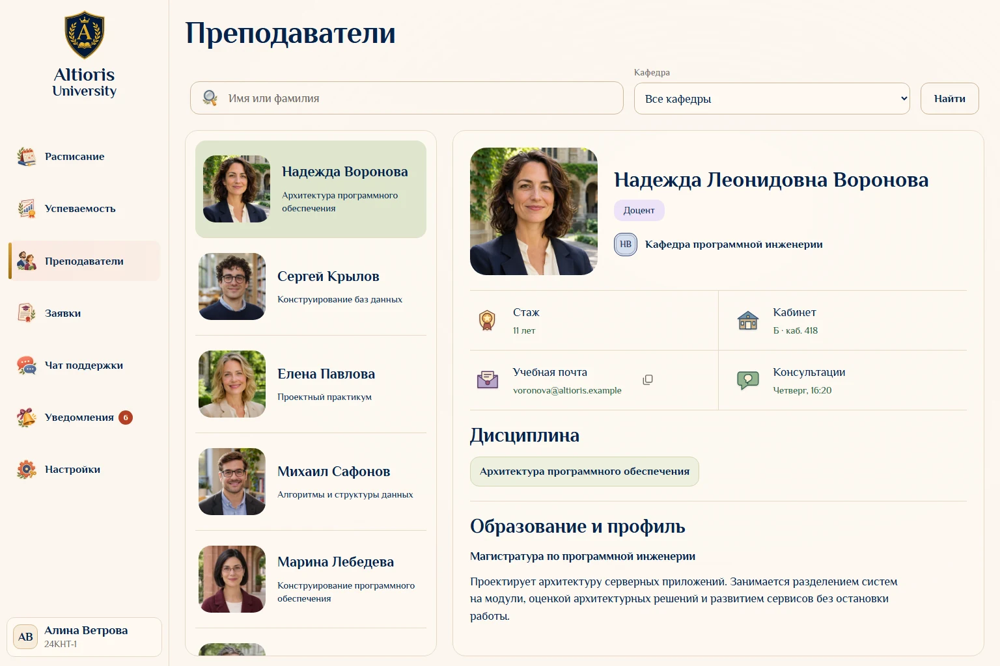
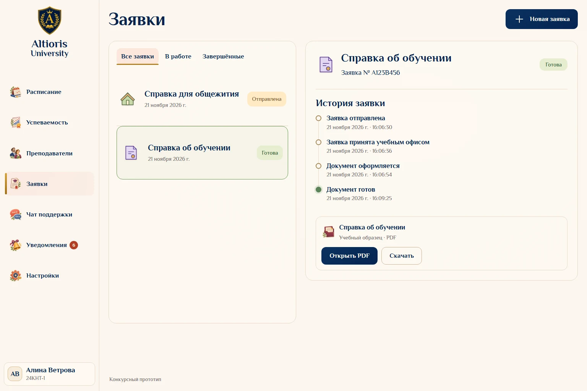
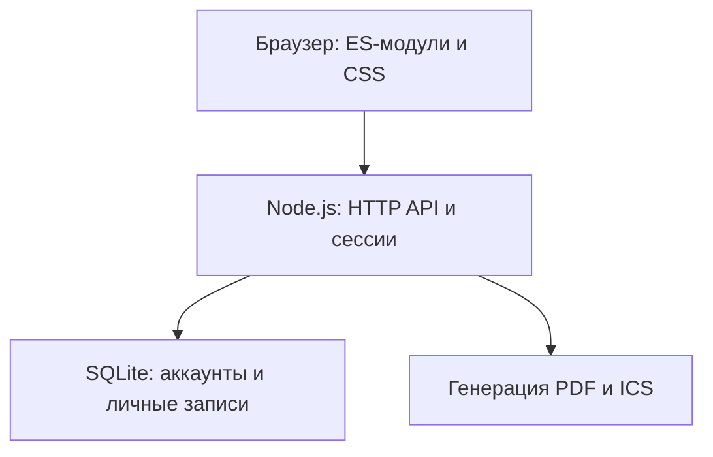

<p align="center"></p>

<h1 align="center">Altioris University</h1>
<p align="center">Цифровой деканат: от следующего занятия до готовой справки.</p>
<p align="center"><a href="https://31-77-222-138.sslip.io/"><strong>Открыть демо Altioris ↗</strong></a></p>
<p align="center">
  <a href="https://github.com/sonjiwu2/altioris/actions/workflows/checks.yml"></a>
  <a href="https://nodejs.org/"></a>
  <a href="LICENSE"></a>
</p>

Altioris — русскоязычный личный кабинет студента для вымышленного университета. В нём можно найти следующую пару, посмотреть оценки, связаться с преподавателем, заказать справку и проверить её готовность. Заявки, документы, уведомления и переписка привязаны к аккаунту и доступны при входе с компьютера и телефона.

Публичное демо работает по HTTPS на VPS. Для входа используйте постоянный демо-аккаунт, выданный организатором. Для собственной копии ниже есть локальный запуск с отдельной базой.


*Работающее расписание, снятое на тестовых данных. [Галерея десктопных и мобильных экранов](docs/images/README.md).*

## Как посмотреть демо

1. Откройте расписание и выберите занятие или экзамен, чтобы увидеть время, аудиторию и преподавателя.
2. В «Заявках» запросите справку об обучении. В карточке появится история обработки, а через 2–3 минуты при нормальной работе очереди станет доступен учебный PDF.
3. В чате спросите «Где мой QR-код пропуска?» или «Как переключить тёмную тему?». В меню «Что можно спросить» собраны ещё примеры.
4. На телефоне откройте меню слева. Детали занятия, преподавателя и заявки открываются поверх текущего списка.

## Быстрый старт

Нужен **Node.js 24 или новее**. Внешних npm-зависимостей и отдельной сборки нет. Python нужен только для проверки референсов.

```powershell
git clone https://github.com/sonjiwu2/altioris.git
Set-Location altioris
npm.cmd run demo:init
notepad .\runtime\demo-accounts.json
```

В созданном JSON задайте каждому из 13 логинов свой постоянный пароль длиной **12–128 символов**, сохраните файл и выполните:

```powershell
npm.cmd run demo:setup
npm.cmd run dev
```

Откройте адрес из строки `Altioris is ready`. Обычно это **http://127.0.0.1:3000**; если порт занят, выбирается свободный. Остановка — `Ctrl+C` в окне сервера.

Для проверки на телефоне в той же доверенной сети Wi‑Fi запустите `node scripts/start-lan-preview.mjs <IPv4-компьютера> 60872`. Откройте напечатанный адрес и войдите своим обычным демо-логином. Запросы идут в тот же процесс Altioris на ПК, поэтому используются одна база и общая история. Локальный HTTP-адрес предназначен для тестирования внутри сети. Для публичного доступа предусмотрено отдельное HTTPS-развёртывание.

Логины подготовлены заранее: `vetrova`, `zolotov`, `orlova`, `gromov`, `belova`, `serov`, `lanskaya`, `severin`, `rudin`, `lesina`, `melnikov`, `safonova`, `volkov`. Пароли задаются отдельно для каждой установки и не публикуются. Их локальная таблица после проверки — `runtime/ACCOUNTS.txt`.

**Для уже настроенной копии достаточно `npm.cmd run dev`.** Повторные `demo:init` и `demo:setup` не заменяют пароли. Это постоянные аккаунты, без одноразовых кодов.

## Возможности

| Раздел | Что реализовано |
| --- | --- |
| Расписание | План 2026/27 и архив 2025/26, чередующиеся недели двух групп, переход к дате, аудитории и темы пар |
| Экзамены | Зимняя и летняя сессии, результаты из зачётки за семестр или год |
| Успеваемость | Зачётка за год или семестр, опубликованные оценки, зачётные единицы и взвешенный GPA |
| Рейтинг | Публикация после зимней и летней сессий, история и изменение места среди включённых аккаунтов |
| Преподаватели | Поиск, кафедры, биографии, консультации и копирование почты |
| Заявки и документы | Фоновая обработка, живая история, уведомление о готовности и пять персональных PDF-шаблонов |
| Поддержка | Быстрые вопросы и уточнения по своим заявкам, оценкам и занятиям. [Как работает помощник](docs/support.md) |
| Уведомления | Фоновая публикация новостей вуза и учебных изменений, счётчик, звук и отметки о прочтении |
| Настройки | Светлая, тёмная и системная тема, размер текста 100/115/130%, текущий сеанс и выход |
| Профиль | Учебные сведения, своё фото, двусторонний пропуск, вымышленные паспорт и аттестат |

<details>
<summary>Преподаватели, заявки и поддержка</summary>






</details>

### Поддержка и документы

Автоматический помощник отвечает по правилам, каталогу университета и данным авторизованного студента. Он подбирает нужный раздел по формулировке вопроса, учитывает уместные уточнения и сохраняет ответы в общей истории аккаунта. [Вопросы и ожидаемые ответы](docs/support.md).

Учебный офис обрабатывает заявки обычно за 2–3 минуты. В истории отображаются отправка, приём, оформление и готовность. После готовности студент получает уведомление и может открыть или скачать PDF. Для академического отпуска и медиалаборатории PDF подтверждает регистрацию обращения. Паспорт и аттестат открываются из профиля. Все документы используют данные текущего аккаунта и помечены как демонстрационные.

[Правила публикации и фоновой очереди уведомлений](docs/academic-events.md).

Университет, личности и записи вымышлены. Учебный план Altioris составлен по мотивам открытых университетских материалов. [Источники и правила учебного календаря](docs/academic-year.md). Подключение к настоящему вузу, видеоконференции и административная панель не реализованы. Тема и размер текста сохраняются отдельно для аккаунтов в текущем браузере.

## Устройство проекта



| Путь | Содержимое |
| --- | --- |
| `public/` | Интерфейс, SVG-иконки, WebP и локальные WOFF2-шрифты |
| `server/` | HTTP, сессии, SQLite, исходные данные, поддержка и экспорты |
| `scripts/` | Запуск, подготовка аккаунтов, проверки референсов и руководств |
| `tests/` | HTTP-интеграция, приватность и сценарии поддержки |
| [`docs/`](docs/README.md) | Требования, архитектура, промпты, инструкции, дизайн и развёртывание |
| `runtime/` | Локальные база, пароли и служебные файлы; исключены из Git |

Пароли хешируются через `scrypt`, сессии передаются в HttpOnly SameSite cookie. Сервер проверяет владельца документов, заявок и сообщений, origin изменяющих запросов и частоту входа. GPA рассчитывается по числовым оценкам с весом дисциплин в кредитах; зачёты без числа исключаются. Рейтинг использует неокруглённый GPA и имя при равенстве баллов.

Это учебный прототип. Границы использования и сообщения об уязвимостях — в [SECURITY.md](SECURITY.md).

## Проверки

```powershell
npm.cmd test
python scripts/import-references.py
node scripts/install-skills.mjs
```

Тесты используют временные данные и не требуют ваших паролей. Проверяются вход и выход, изоляция аккаунтов, перезапуск, закрытые PDF, валидация, лимиты входа и поддержка. Дополнительные команды сверяют SHA-256 11 референсов и структуру 30 руководств. Эти проверки настроены в GitHub Actions.

## Документация и развитие

- [Карта документации](docs/README.md).
- [Требования](docs/requirements.md) и [архитектура](docs/architecture.md).
- [Визуальная система](DESIGN.md) и [11 референсов](docs/references/README.md).
- [Запросы на разработку и правки на английском](docs/prompts/development/README.md), [ролевые промпты](docs/prompts/README.md) и [руководства разработки](docs/implementation-guides/README.md).
- [Внесение изменений](CONTRIBUTING.md), [история изменений](CHANGELOG.md), [происхождение ресурсов](docs/licenses/ASSET_REGISTER.md).

## Публикация

Для работы всех функций нужен Node.js 24+, постоянный диск для SQLite и HTTPS. Обновление ветки на GitHub и обновление запущенного сервиса выполняются отдельно. [Порядок выпуска](docs/release.md) · [Настройка сервера](docs/deployment.md).

## Лицензия

Код и авторская документация — [MIT](LICENSE). Шрифты — **SIL Open Font License 1.1**, уведомления сохранены рядом с файлами. Иллюстрации и сторонние материалы описаны в [THIRD_PARTY_NOTICES.md](THIRD_PARTY_NOTICES.md).
